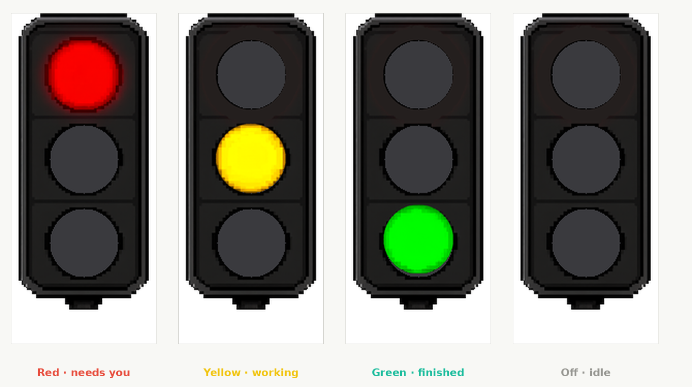
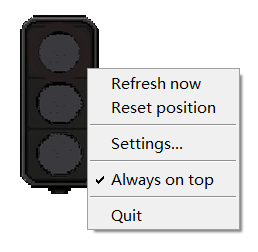
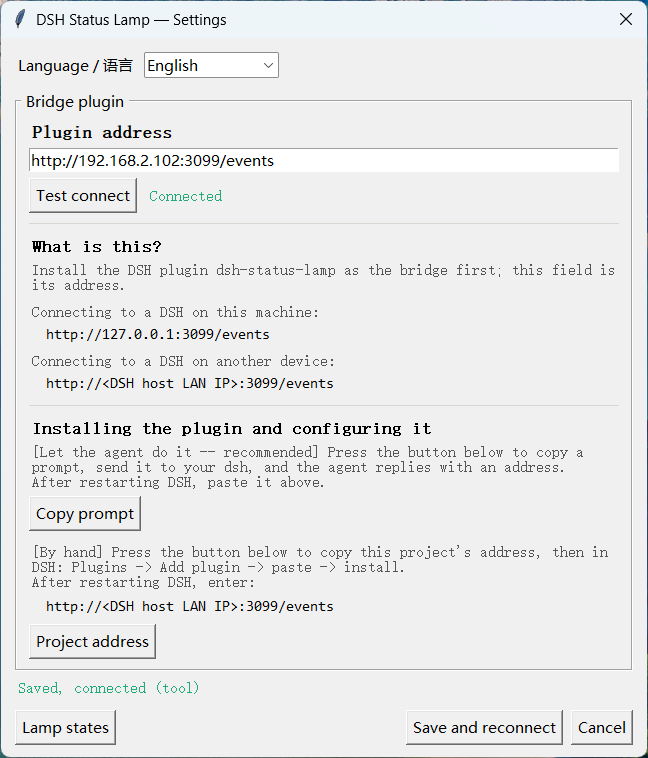
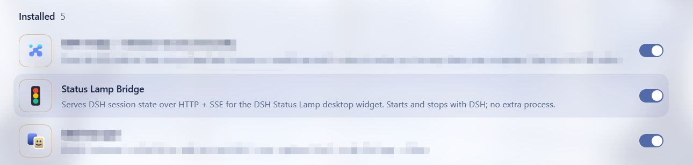

# DSH Status Lamp

A traffic-light desktop widget for Windows, with a matching DSH plugin. One glance tells you what DSH is doing: yellow 🟡 while it works, red 🔴 when it needs you, green 🟢 when the turn is done.

No window switching, no log tailing. A glance out of the corner of your eye.

> **How this was built**: driven end to end by **DSH** (DeepSeek Harness) running **DeepSeek V4.1 Flash**, as a vibecoding exercise. The sprites were generated with ComfyUI and then trimmed by the scripts under `tools/`.

[中文](README.md) | **English**

## Contents

- [1. Preview](#1-preview)
  - [1.1 What the lamp means](#11-what-the-lamp-means)
- [2. Configuration](#2-configuration)
  - [2.1 Context menu](#21-context-menu)
  - [2.2 Settings window](#22-settings-window)
- [3. Getting started](#3-getting-started)
  - [3.1 Install the lamp](#31-install-the-lamp-desktop-widget)
  - [3.2 Install the DSH plugin](#32-install-the-dsh-plugin-bridge)
  - [3.3 Point the lamp at the bridge](#33-point-the-lamp-at-the-bridge)
- [4. Technical notes](#4-technical-notes)
  - [4.1 How the state is derived](#41-how-the-state-is-derived)
  - [4.2 On read receipts](#42-on-read-receipts----can-the-green-wait-until-i-have-read-the-messages)
- [5. License](#5-license)
- [6. Changelog](#6-changelog)

---

## 1. Preview



### 1.1 What the lamp means

| Lamp | Meaning | When |
|---|---|---|
| 🔴 Red | **Needs you** | An approval dialog is open (waiting for allow)<br>The agent asked you a question |
| 🟡 Yellow | **Working** | Running a tool / reasoning / generating / retrying<br>A new turn just started |
| 🟢 Green | **Just finished** | Stays green for three minutes; turns yellow when you send the next message |
| ⚪ Off | **Idle** | Nothing in progress, or the data cannot be read |

---

## 2. Configuration

### 2.1 Context menu



| Item | What it does |
|---|---|
| **Refresh now** | Fetch the state again instead of waiting for the next push |
| **Reset position** | Bring the lamp back if it was dragged somewhere invisible |
| **Always on top** | Whether it floats above other windows |
| **Play a sound when a task finishes or needs you** | A chime when a turn ends or the lamp turns red |
| **Breathe the light** | The lit bulb cycles between 60% and 100% brightness, pausing a second at full |
| **Lamp size** | Small, medium or large; takes effect immediately |
| **Settings…** | Opens the window below |
| **Quit** | Closes the lamp |

**Each of these applies and saves immediately** -- there is no save button.

### 2.2 Settings window



| Item | Meaning |
|---|---|
| **Language / 语言** | Chinese or English; the interface changes as soon as you pick one |
| **Plugin address** | The only required setting. `http://127.0.0.1:3099/events` when the lamp and DSH share a machine; the DSH host's LAN address otherwise |
| **Test connect** | One request to the bridge's `/state`, purely to check the network |
| **Installing the plugin and configuring it** | Two ways to install the bridge: copy a prompt for your agent, or copy the project address and do it by hand |

**Where the bridge goes** (and the address is that same machine):

The bridge is the `packages/dsh-lamp` DSH plugin: add
`github:oitsukiii/dsh-status-lamp#path:/packages/dsh-lamp` in DSH's Plugins page
and restart DSH. It starts and stops with DSH; there is no process to watch.

---

## 3. Getting started

Two things to install: **the lamp on your desktop**, and **the bridge plugin on the machine running DSH**.

### 3.1 Install the lamp (desktop widget)

**A · Download for Windows** (recommended)

[**Download DSH-Lamp.exe**](https://github.com/oitsukiii/dsh-status-lamp/releases/latest) — no Python needed, just run it.

**B · Run from source**

Needs Python 3.9+ and Pillow:

```bash
git clone https://github.com/oitsukiii/dsh-status-lamp.git
cd dsh-status-lamp
pip install pillow
python client/lamp.py
```

### 3.2 Install the DSH plugin (bridge)

Two ways to install it; pick one. **The agent route is recommended** -- it edits the
configuration itself and knows the pitfalls.

**A · Let the agent do it** (recommended)

Send the text the "Copy prompt" button puts on your clipboard to the agent on the DSH
machine. It installs the plugin and replies with the address to use.

**B · Add it by hand in the DSH interface**

Add this in DSH's Plugins page:

```
github:oitsukiii/dsh-status-lamp#path:/packages/dsh-lamp
```

Then restart DSH.

**Either way, it shows up in DSH's plugin list once installed:**



### 3.3 Point the lamp at the bridge

Right-click the lamp, choose **Settings**, and set **Plugin address** to the machine
running DSH:

Lamp and DSH on the **same** machine -> `http://127.0.0.1:3099/events`

Lamp and DSH on **different** machines -> `http://<the DSH host's LAN address>:3099/events`

Press **Test connect** to confirm it answers, then **Save and reconnect**.

---

## 4. Technical notes

### 4.1 How the state is derived

Two generations, differing in where the state comes from.

#### 4.1.1 From v1.1.0 (current): subscribe to session events

The bridge is a DSH plugin running inside the DSH process, subscribing to `session/event`:

```
DSH commits an event ──► plugin folds it ──► SSE pushes to the lamp
```

| Event | Lamp |
|---|---|
| `approval/asked` | 🔴 Needs you (waiting for allow) |
| `tool/call` whose tool is `ask_user_question` | 🔴 Needs you (waiting for an answer) |
| `tool/call` | 🟡 Working (with the tool name) |
| `step/start` / `assistant/message` | 🟡 Working |
| `llm/retry` | 🟡 Retrying |
| `turn/end` | 🟢 Just finished (for three minutes) |

**Why it is better**: an event is visible the moment it is committed, with no wait for
a disk write; nothing polls, nothing decompresses, no zstd decoder is needed; and each
event carries its session id, so two sessions cannot be mixed together.

#### 4.1.2 v1.0.0: poll the snapshot, decompress the log tail

No plugin. The bridge was a separate process, so it could only read from disk:

| Data | Location | Character |
|---|---|---|
| State snapshot | `~/.dsh/storages/session_projcache/sessions/*.json` | Structured, but **written lazily** (every few tens of seconds) |
| Event log | `~/.dsh/sessions/<project>/<session>/session.v4.jsonl.zstd` | Written often, but compressed and hundreds of megabytes |

So it had to watch both: the snapshot for coarse state (is a turn open, is a call
waiting for approval) and the log for detail (`step/start` means reasoning,
`tool/call` means running a tool). The log was read by seeking to the end, finding a
frame header and decompressing only the last few hundred kilobytes.

**Limits**: tied to DSH's write timing, so it lagged whenever the snapshot was stale;
needed a zstd decoder; and the snapshot and the log were each chosen by newest mtime,
so in principle they could belong to different sessions.

### 4.2 On read receipts -- can the green wait until I have read the messages?

**No. DSH has no notion of "read", so the lamp cannot know whether you looked.**

The green starts its three-minute timer when the turn ends, regardless.

What was checked:

| Looked for | Found |
|---|---|
| Fields like `unread` / `markRead` / `lastRead` | Only "unread **bytes**" from truncated shell output -- nothing about people |
| The client reporting attention (`visibilitychange`, `document.hidden`, `hasFocus`) | Present, but only for local behaviour: releasing a microphone, cancelling a recording, retrying a request. Nothing is sent to the host |
| Client-to-host connection state | Network availability only, not "someone is looking" |
| The `delivery-accepted` event | A session-log format marker, **not** "the user received this" |

**The architectural reason**: the DSH web client never tells the host that a person is watching. The host knows an event was committed; it does not know whether anything rendered it on screen.

The nearest signals are all wrong:

```
the time of the last user/message   -- that is speaking, not reading
the time of the last event          -- that is DSH working, not the user
the client being online             -- a background tab counts as online
```

**Making the green depend on reading would mean changing the DSH web client**: report when a message enters the viewport, add an event type, and have the plugin subscribe to it. That is a change to DSH itself, not to this lamp.

**So this lamp answers "what is DSH doing", not "have you read it".**

## 5. License

MIT

---

## 6. Changelog

### v1.1.0 · `874bd32`

[Release](https://github.com/oitsukiii/dsh-status-lamp/releases/tag/v1.1.0)

- **The bridge became a DSH plugin**: it subscribes to session events instead of polling disk, so it needs no zstd decoder and no longer depends on when DSH flushes
- **Settings rewritten**: local and LAN modes merged -- they differed only in one address
- Sound, breathing and size moved into the context menu, applying at once
- Bilingual interface
- Breathing dims only the lit bulb; the housing no longer flickers with it
- Fixed: the windowed build failed to start because of a missing numpy import

### v1.0.0 · `cb0d2f3`

[Release](https://github.com/oitsukiii/dsh-status-lamp/releases/tag/v1.0.0)

- First release: the Python bridge plus the desktop widget
- State came from polling the snapshot and decompressing the tail of the event log
- ⚠️ The exe attached to this release does not start; use v1.1.0
