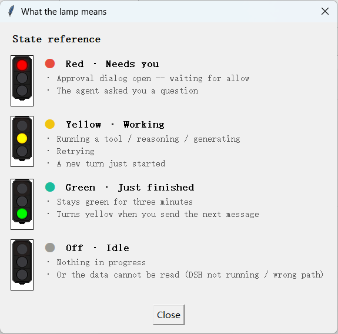
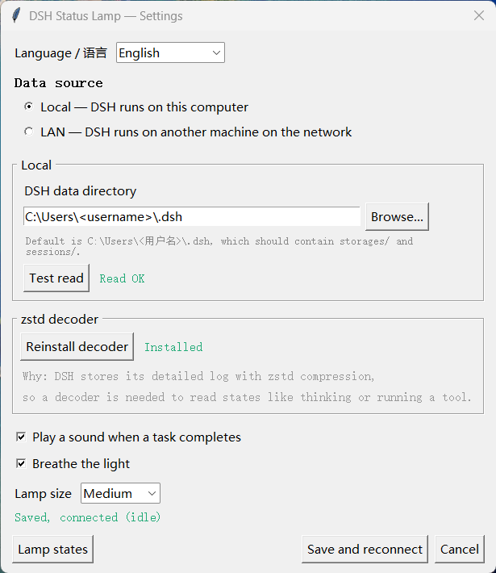
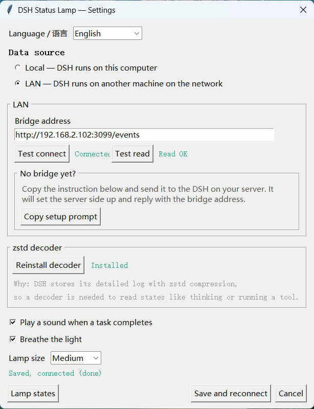

# DSH Status Lamp

[中文](README.md) | **English**



A small desktop widget that tells you at a glance what DSH is doing: reasoning, running a command, waiting for your approval, or finished.

No window switching, no log tailing. A glance out of the corner of your eye.

---

## What the lamp means

| Lamp | Meaning | When |
|---|---|---|
| 🔴 Red | **Needs you** | An approval dialog is open (waiting for allow)<br>The agent asked you a question |
| 🟡 Yellow | **Working** | Running a tool / reasoning / generating / retrying<br>A new turn just started, state not written yet |
| 🟢 Green | **Just finished** | Stays green for three minutes; turns yellow when you send the next message |
| ⚪ Off | **Idle** | Nothing in progress, or the data cannot be read |

Right-click the lamp for the menu:


The `Lamp states` button in the app shows this table with the actual sprites:


---

## Two modes

### Local — DSH runs on this computer

No configuration. The client reads the files under `~/.dsh` directly. No network, no extra process.



### LAN — DSH runs on another machine

That machine runs a bridge, and the client connects to it:

```
[DSH host]  ~/.dsh ──► state_bridge.py ──SSE──► [your machine] lamp
```

The bridge is `bridge/state_bridge.py`. It does one thing: turn DSH's on-disk state into one of four colours and push it out over HTTP + SSE.



---

## Getting started

### Requirements

- Python 3.9+
- Pillow, for the sprites (without it the lamp falls back to a drawn circle)
- A zstd decoder, for the event log (optional but recommended):
  - Built in on Python 3.14+
  - Otherwise `pip install pyzstd`
  - **There is a one-click install button in settings**

### Local mode (simplest)

```bash
git clone https://github.com/oitsukiii/dsh-status-lamp.git
cd dsh-status-lamp
pip install pillow
python client/lamp.py
```

Right-click the lamp to open settings.

### LAN mode

On the machine running DSH:

```bash
python bridge/state_bridge.py --host 0.0.0.0 --port 3099
```

Then on your own machine: right-click the lamp → Settings → LAN mode → enter

```
http://<DSH host IP>:3099/events
```

⚠️ It is `/events`, not `/state` — the former is the push stream, the latter a one-shot query.

Do not expose port 3099 directly: the bridge has no authentication. Use WireGuard or an SSH tunnel for anything beyond your own network.

See `deploy/dsh-status-bridge.service` for a systemd unit.

---

## How the state is derived

DSH writes two things:

| Data | Location | Character |
|---|---|---|
| State snapshot | `~/.dsh/storages/session_projcache/sessions/*.json` | Structured, but **written lazily** (every few tens of seconds) |
| Event log | `~/.dsh/sessions/<project>/<session>/session.v4.jsonl.zstd` | Written often, but compressed and hundreds of megabytes |

The lamp reads both:

- The **snapshot** gives coarse state — whether a turn is open, whether a tool call is waiting for approval
- The **event log** gives fine state — `step/start` means reasoning, `tool/call` means running a tool, `approval/asked` means waiting for you

Snapshot alone lags by ten or more seconds at the start of a turn; the log alone cannot tell you who is waiting on an approval.

The log is read by seeking to the end, locating a frame header, and decompressing only the last few hundred kilobytes — never the whole file.

---

## Latency

**2–4 seconds**, depending on when DSH flushes.

That is the floor. Measured: the bridge costs 30–40 ms, SSE is milliseconds, and everything else is DSH's write. If DSH does not write, the lamp cannot see it, and no polling interval will change that.

The green appears immediately though, because `turn/end` is written to the event log right away.

---

## Other bits

- **Breathing** — brightness cycles between 60% and 100%, pausing a second at full, toggleable
- **Sound** — a chime when a turn completes, toggleable
- **Size** — small, medium or large
- **Bilingual** — Chinese and English, switchable in settings
- **High DPI** — declares per-monitor DPI awareness, so text stays sharp on scaled displays

---

## How this was built

This project was **vibecoded**:

- Runtime: **DSH** (DeepSeek Harness)
- Model: **DeepSeek V4.1 Flash** (`deepseek-flash`)
- Everything came from describing what was wanted, running it, noticing what was wrong, and saying so

No design document up front, no architecture diagram. All the code, the asset-processing scripts and this README came out of that loop.

The sprites were generated with ComfyUI, then trimmed and adjusted by the scripts under `tools/`.

---

## License

MIT
