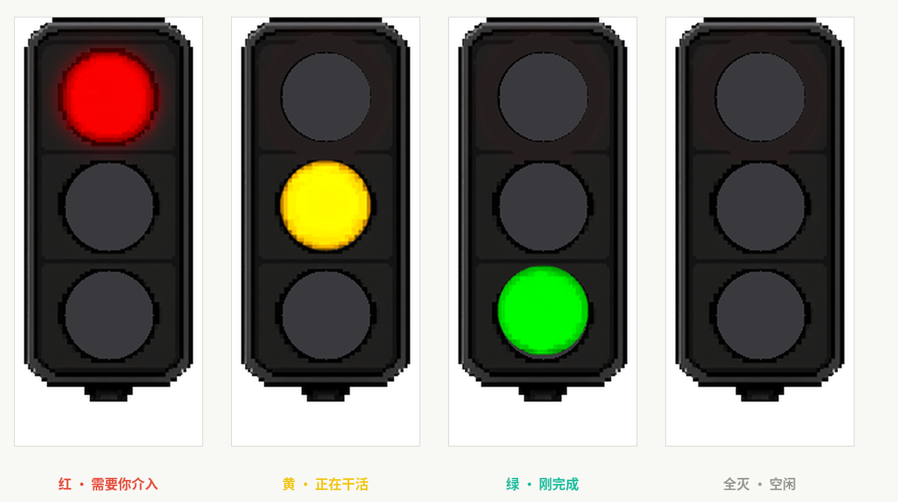
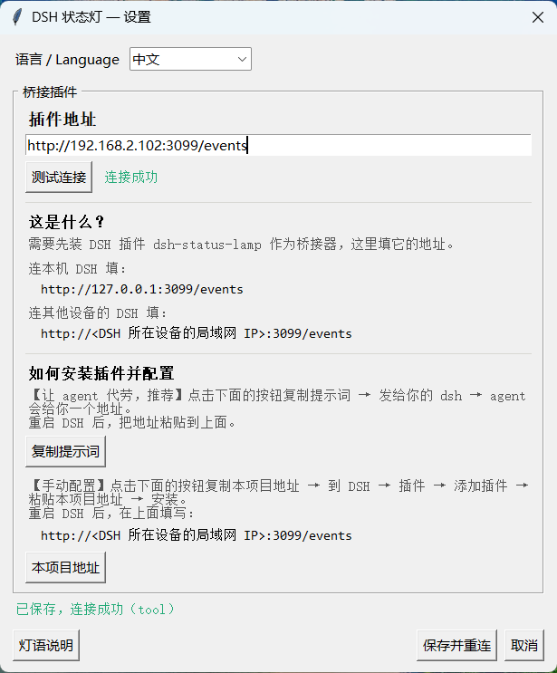
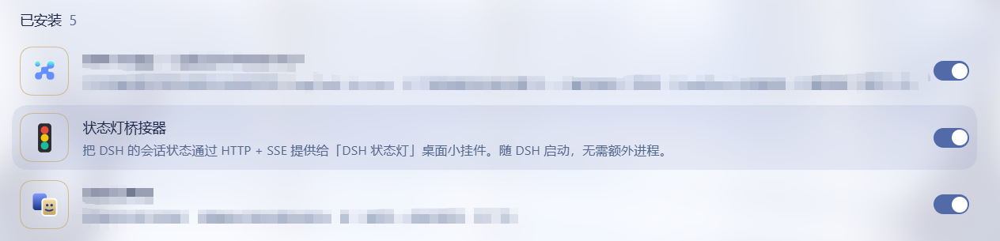

# DSH 状态灯

一个信号灯样式的 Windows 桌面小挂件，以及配套的 DSH 插件。一眼看出 DSH 此刻在干什么：工作中显示黄灯 🟡、需要你介入显示红灯 🔴、会话结束显示绿灯 🟢。

不用切窗口，不用看日志，余光扫一下就行。

> **开发方式**：本项目由 **DSH**（DeepSeek Harness）驱动 **DeepSeek V4.1 Flash** 以 vibecoding 方式完成。素材（三色灯精灵图）由 ComfyUI 生成，再用 `tools/` 下的脚本裁切、去凸起、改未亮灯泡的颜色。

**中文** | [English](README.en.md)

## 目录

- [1. 效果预览](#1-效果预览)
  - [1.1 灯语](#11-灯语)
- [2. 配置细节](#2-配置细节)
  - [2.1 右键菜单](#21-右键菜单)
  - [2.2 设置窗口](#22-设置窗口)
- [3. 快速开始](#3-快速开始)
  - [3.1 状态灯](#31-状态灯桌面小挂件)
  - [3.2 DSH 插件](#32-dsh-插件桥接器)
- [4. 一些技术细节](#4-一些技术细节)
  - [4.1 状态是怎么判断的](#41-状态是怎么判断的)
  - [4.2 关于已读](#42-关于已读绿灯能不能等我看了-dsh-消息再熄灭)
- [5. 许可](#5-许可)
- [6. 更新日志](#6-更新日志)

---

## 1. 效果预览



### 1.1 灯语

| 灯 | 含义 | 什么时候亮 |
|---|---|---|
| 🔴 红 | **需要你介入** | 审批弹窗挂起（等你点「允许」）<br>agent 主动提问（等你回答） |
| 🟡 黄 | **正在干活** | 调工具 / 推理 / 生成 / 重试<br>刚开的新一轮 |
| 🟢 绿 | **刚完成** | 一轮结束后保持 3 分钟，你发下一条消息就变黄 |
| ⚪ 全灭 | **空闲** | 没有进行中的任务，或读不到数据 |

---

## 2. 配置细节

### 2.1 右键菜单


| 选项 | 作用 |
|---|---|
| **立即刷新** | 强制重新取一次状态，不等下一次推送 |
| **回到右下角** | 灯被拖到看不见的地方时用它找回来 |
| **始终置顶** | 是否浮在所有窗口之上 |
| **完成或需要你介入时播放提示音** | 一轮结束、或亮红灯时响一下 |
| **灯光呼吸效果** | 点亮的灯泡在 60%~100% 亮度之间来回，到最亮停 1 秒 |
| **灯的大小** | 小 / 中 / 大三档，选了立刻生效 |
| **设置…** | 打开下面的配置窗口 |
| **退出** | 关掉灯 |

**这些都立刻生效并自动存盘**，不需要点保存。

### 2.2 设置窗口



| 项目 | 说明 |
|---|---|
| **语言 / Language** | 中文 / English，切换后界面立刻变 |
| **插件地址** | 灯唯一的必需配置。本机填 `http://127.0.0.1:3099/events`；DSH 在别的设备上就填那台机的局域网 IP |
| **测试连接** | 请求一次桥的 `/state`，只验证网络能不能通 |
| **如何安装插件并配置** | 两种装桥的方式：让 agent 自己装（复制提示词），或手动装（复制项目地址） |

**桥的装法**（装在哪台机器上，灯就填哪台机的地址）：

桥是 `packages/dsh-lamp` 这个 DSH 插件：在 DSH 的「插件」页添加
`github:oitsukiii/dsh-status-lamp#path:/packages/dsh-lamp`，重启 DSH 即可。
它随 DSH 起停，不用管进程。

---

## 3. 快速开始

装两样东西：**桌面上的状态灯**，以及**DSH 那台机器上的桥接插件**。

### 3.1 状态灯（桌面小挂件）

**Windows 直接下载**（推荐）：

[**下载 DSH-Lamp.exe**](https://github.com/oitsukiii/dsh-status-lamp/releases/latest) —— 不需要装 Python，双击就能跑。

**从源码跑**需要 Python 3.9+ 和 Pillow：

```bash
git clone https://github.com/oitsukiii/dsh-status-lamp.git
cd dsh-status-lamp
pip install pillow
python client/lamp.py
```

启动后右键灯打开设置。

### 3.2 DSH 插件（桥接器）

装桥有两种方式，选一种。**推荐让 agent 自己装** —— 它会自己改配置、处理踩坑。

**方式 A · 让 agent 自己装**（推荐）

把设置窗口里「复制提示词」按钮复制的那段，发给 DSH 那台机器上的 agent。它会装好，并把要填的地址告诉你。

**方式 B · 在 DSH 界面里手动装**

在 DSH 的「插件」页添加：

```
github:oitsukiii/dsh-status-lamp#path:/packages/dsh-lamp
```

装好重启 DSH。

**不论哪种方式，装好后都能在 DSH 的插件清单里看到它：**



最后，把灯设置里的地址填成桥所在的那台机器：

```
灯和 DSH 同一台机器   →  http://127.0.0.1:3099/events
灯在另一台机器        →  http://<那台机器的局域网 IP>:3099/events
```

---

## 4. 一些技术细节

### 4.1 状态是怎么判断的

两代实现，差别在「从哪儿拿状态」。

#### 4.1.1 v1.1.0 起（当前）：订阅会话事件

桥是一个 DSH 插件，跑在 DSH 进程内，直接订阅 `session/event`：

```
DSH 提交事件 ──► 插件同步 fold ──► SSE 推给灯
```

| 事件 | 灯 |
|---|---|
| `approval/asked` | 🔴 需要你介入（等你点「允许」） |
| `tool/call` 且工具名是 `ask_user_question` | 🔴 需要你介入（等你回答） |
| `tool/call` | 🟡 正在干活（附工具名） |
| `step/start` / `assistant/message` | 🟡 正在干活 |
| `llm/retry` | 🟡 重试中 |
| `turn/end` | 🟢 刚完成（保持 3 分钟） |

**好处**：事件一提交就能看到，不用等落盘；不轮询、不解压、不需要 zstd 解码器；
事件自带会话 id，不会把两个会话的数据拼在一起。

#### 4.1.2 v1.0.0：轮询快照 + 解压日志尾部

没有插件，桥是独立进程，只能从磁盘读：

| 数据 | 位置 | 特点 |
|---|---|---|
| 状态快照 | `~/.dsh/storages/session_projcache/sessions/*.json` | 结构化，但**写得很懒**（几十秒一次） |
| 事件日志 | `~/.dsh/sessions/<项目>/<会话>/session.v4.jsonl.zstd` | 写得勤，但压缩过、几百 MB |

于是要**同时**看两样：快照给粗粒度（有没有 turn 开着、有没有待审批的调用），
事件日志给细粒度（`step/start` = 在推理、`tool/call` = 在跑工具）。
事件日志用「跳到文件尾部找帧头、只解压最后几百 KB」的方式读，不整份解压。

**局限**：受 DSH 落盘时机影响，快照懒写的时候会滞后；要装 zstd 解码器；
快照和日志各取最新的，理论上可能来自不同会话。


### 4.2 关于「已读」——绿灯能不能等我看了 DSH 消息再熄灭？

**不能。DSH 里没有「已读」这个概念，灯无法知道你有没有看过。**

绿灯现在是「一轮结束」就开始计时，3 分钟后熄灭，和你看没看无关。

查过的位置：

| 找什么 | 结果 |
|---|---|
| `unread` / `markRead` / `lastRead` 之类的字段 | 只有「未读的**字节**」（shell 输出截断），和用户无关 |
| 客户端上报视线（`visibilitychange` / `document.hidden` / `hasFocus`） | 有，但只用于**本地**行为：页面隐藏时放开麦克风、取消录音、重试请求。**不上报服务端** |
| 客户端 ↔ 服务端的连接状态 | 只有「网络是否可用」，不是「有人在看」 |
| `delivery-accepted` 事件 | 是会话日志格式的迁移标记，**不是**「用户已接收」 |

**架构上的原因**：DSH 的 Web 客户端不向服务端回报任何「我正在看」的信号。服务端只知道事件被提交了，不知道有没有人渲染到屏幕上。

能拿到的最接近的东西，都不准：

```
user/message 事件的时间     ← 那是「发言」，用户可能看了没回
最后一条事件的时间          ← 那是 DSH 在干活，和用户无关
客户端网络在线              ← 后台标签页也算在线
```

**要真做到「看了才熄灭」，得改 DSH 的 Web 客户端**：消息进入视口时上报一次，新增一个事件类型，插件订阅它。那是改 DSH 本体，不是改这盏灯。

**所以现在这盏灯能回答「DSH 在干什么」，不能回答「你看过了吗」。**

## 5. 许可

MIT

---

## 6. 更新日志

### v1.1.0 · `874bd32`

[Release](https://github.com/oitsukiii/dsh-status-lamp/releases/tag/v1.1.0)

- **桥改成 DSH 插件**：订阅会话事件，不再轮询磁盘。因此不再需要 zstd 解码器，也不再受 DSH 落盘时机影响
- **设置窗口重写**：「本机模式」和「局域网模式」合并 —— 两者只差一个地址
- 提示音、呼吸灯、大小移进右键菜单，点了立刻生效
- 界面中英双语
- 呼吸灯只调点亮那颗灯泡，灯罩不再跟着闪
- 修复：窗口版 exe 因缺少 numpy 无法启动

### v1.0.0 · `cb0d2f3`

[Release](https://github.com/oitsukiii/dsh-status-lamp/releases/tag/v1.0.0)

- 第一个版本：Python 桥 + 桌面挂件
- 状态来自轮询快照 + 解压事件日志尾部
- ⚠️ 这个版本附带的 exe 起不来，请用 v1.1.0
