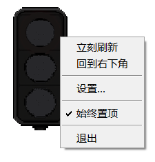
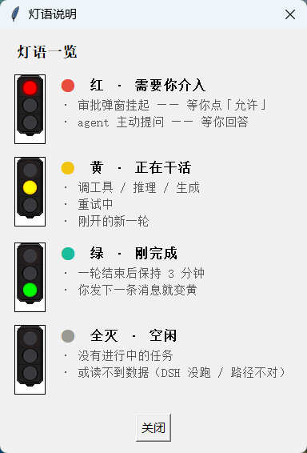
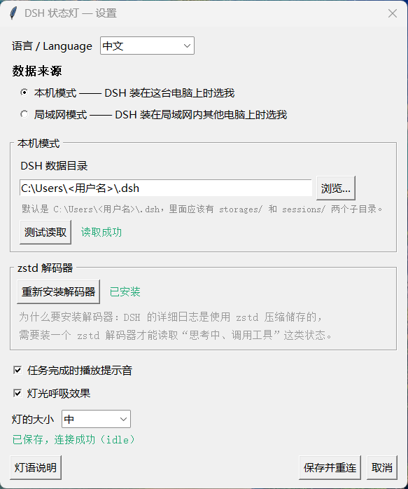
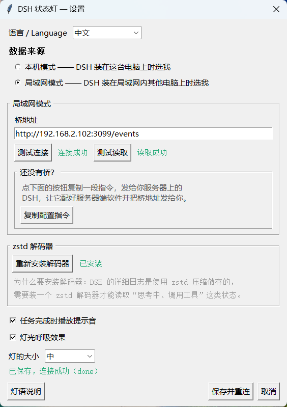

# DSH 状态灯

**中文** | [English](README.en.md)

一个桌面小挂件，一眼看出 DSH 此刻在干什么：在推理、在跑命令、在等你审批，还是已经完事了。

不用切窗口，不用看日志，余光扫一下就行。

## 目录

- [灯语](#灯语)
- [两种模式](#两种模式)
- [快速开始](#快速开始)
- [状态是怎么判断的](#状态是怎么判断的)
- [其他](#其他)
- [开发方式](#开发方式)
- [许可](#许可)

---

## 灯语

| 灯 | 含义 | 什么时候亮 |
|---|---|---|
| 🔴 红 | **需要你介入** | 审批弹窗挂起（等你点「允许」）<br>agent 主动提问（等你回答） |
| 🟡 黄 | **正在干活** | 调工具 / 推理 / 生成 / 重试<br>刚开的新一轮（状态还没落盘） |
| 🟢 绿 | **刚完成** | 一轮结束后保持 3 分钟，你发下一条消息就变黄 |
| ⚪ 全灭 | **空闲** | 没有进行中的任务，或读不到数据 |

右键灯可以打开菜单：



程序里 `灯语说明` 按钮会把这个表连同实际灯的样子一起显示出来：



---

## 两种模式

### 本机模式 —— DSH 装在这台电脑上

零配置。客户端直接读 `~/.dsh` 下的文件，不需要网络、不需要额外进程。



### 局域网模式 —— DSH 装在另一台机器上

DSH 那台机器跑一个「状态桥」，客户端连过去：

```
[DSH 主机]  ~/.dsh ──► state_bridge.py ──SSE──► [你的电脑] 状态灯
```

桥是 `bridge/state_bridge.py`，只做一件事：把 DSH 的落盘状态折叠成四色，通过 HTTP + SSE 推出去。



---

## 快速开始

### 直接下载（Windows）

[**下载 DSH-Lamp.exe**](https://github.com/oitsukiii/dsh-status-lamp/releases/latest) —— 不需要装 Python，双击就能跑。

### 从源码跑

需要 Python 3.9+，另外：

- **Pillow** —— 显示图片素材（没有就退回画一个圆点）
- **zstd 解码器** —— 读事件日志用，可选但强烈建议：
  - Python 3.14+ 自带
  - 否则 `pip install pyzstd`
  - **设置窗口里有一键安装按钮**

#### 本机模式（最简单）

```bash
git clone https://github.com/oitsukiii/dsh-status-lamp.git
cd dsh-status-lamp
pip install pillow
python client/lamp.py
```

启动后右键灯可以打开设置。

#### 局域网模式 · 方式 A：DSH 插件（推荐）

如果 DSH 那台机器装了 DSH，可以直接装成插件 —— 随 DSH 启动，不用管进程：

在 DSH 的「插件」页面添加：

```
github:oitsukiii/dsh-status-lamp#path:/packages/dsh-lamp
```

装好重启 DSH，它会监听 `3099`，灯里填 `http://<那台机器>:3099/events` 即可。

**这个方式比下面的 Python 桥快得多**：插件直接订阅会话事件，不轮询文件、不解压日志。

#### 局域网模式 · 方式 B：Python 桥

在 **DSH 所在的那台机器**上：

```bash
python bridge/state_bridge.py --host 0.0.0.0 --port 3099
```

然后在你自己的电脑上，右键灯 → 设置 → 局域网模式 → 填：

```
http://<DSH 主机的 IP>:3099/events
```

⚠️ 注意是 `/events` 不是 `/state` —— 前者是推送流，后者只是一次性查询。

DMZ 里别裸开 3099，桥没有鉴权。要走公网请套 WireGuard 或 SSH 隧道。

部署成服务的示例见 `deploy/dsh-status-bridge.service`。

---

## 状态是怎么判断的

DSH 会写两样东西：

| 数据 | 位置 | 特点 |
|---|---|---|
| 状态快照 | `~/.dsh/storages/session_projcache/sessions/*.json` | 结构化，但**写得很懒**（几十秒一次） |
| 事件日志 | `~/.dsh/sessions/<项目>/<会话>/session.v4.jsonl.zstd` | 写得勤，但压缩过、几百 MB |

灯同时看这两样：

- **快照**给粗粒度状态（有没有 turn 开着、有没有待审批的工具调用）
- **事件日志**给细粒度状态（`step/start` = 在推理，`tool/call` = 在跑工具，`approval/asked` = 等你点允许）

只看快照的话，第二轮开始后的十几秒里灯还是上一个状态；只看日志则拿不到「谁在等审批」这类信息。

事件日志用「跳到文件尾部找帧头、只解压最后几百 KB」的方式读，不整份解压。

---

## 其他

- **呼吸灯**：亮度在 60%~100% 之间来回，到最亮停 1 秒，可在设置里关掉
- **提示音**：一轮完成时响一下，可关
- **大小**：小 / 中 / 大三档
- **中英双语**：设置里切
- **高 DPI**：声明了 per-monitor DPI 感知，缩放屏上字不糊

---

## 开发方式

这个项目是 **vibecoding** 出来的：

- 运行环境 **DSH**（DeepSeek Harness）
- 模型 **DeepSeek V4.1 Flash**（`deepseek-flash`）
- 全程靠对话描述需求、跑起来看、发现问题再改

没有先写设计文档，也没有手写架构图。所有代码、素材处理脚本、这份 README 都是这么来的。

素材（三色灯精灵图）由 ComfyUI 生成，再用 `tools/` 下的脚本裁切、去凸起、改未亮灯泡的颜色。

---

## 许可

MIT
